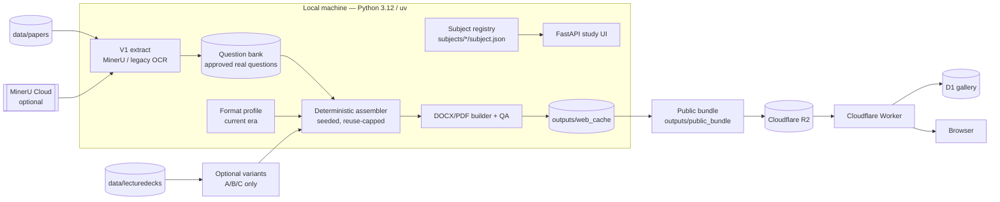
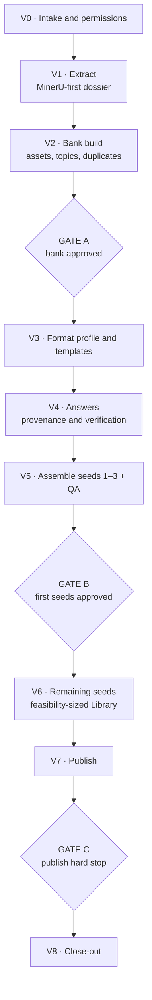
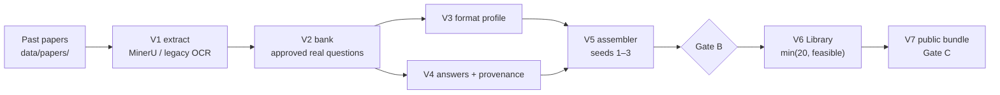

# Mock Paper Generator

A local-first study tool that recycles real past-paper questions into new mock
papers and marking schemes. Generation runs on your machine; the public site is
a **library-only** deployment that serves pre-built papers through Cloudflare.

The project follows one rule: **recycle, don’t invent.** A generated paper is
assembled from approved real past-paper questions, laid out in the current exam
format, with answers whose provenance is recorded.

## Contents

- [At a glance](#at-a-glance)
- [How it fits together](#how-it-fits-together)
- [The three layers](#the-three-layers)
- [The v2 lifecycle](#the-v2-lifecycle)
- [Subject types](#subject-types)
- [How a paper is made](#how-a-paper-is-made)
- [Quick start](#quick-start)
- [Subject status](#subject-status)
- [Repository map](#repository-map)
- [Common commands](#common-commands)
- [Public deployment](#public-deployment)
- [Safety and contribution rules](#safety-and-contribution-rules)
- [Documentation index](#documentation-index)
- [Tests](#tests)

## At a glance

| Item | Value |
|---|---|
| Purpose | Recycle past papers into new mock papers and marking schemes |
| Core model | Question bank + current format profile + deterministic assembler |
| Local runtime | Python 3.12+, FastAPI, `uv` |
| Subjects | 44 registry entries: 5 `available`, 39 `coming_soon` |
| Available locally | CSC402, CSC413, CSC429, CSC662, MAT133 |
| Published | CSC413, CSC429, CSC662, MAT133 |
| Public site | <https://uitmpapergen.download> |
| Public runtime | Cloudflare Worker + R2 + D1; no Python and no LLM |
| Local UI | <http://127.0.0.1:8000> |
| Worker | `cloudflare/worker/` |
| Contact | auzair1990@gmail.com |
| Repository | <https://github.com/jerkfish/paper-generator> |

**Current migration status:** the v2 playbook and audit are in place. The
shared `src/bank/` and `src/assemble/recycle.py` code is the next phase; until
it lands, CSC429 is the reference implementation and finished subjects keep
their current behaviour. ICT450 v1 is not approved; Phase 2b archives it, then
the Phase 4 pilot rebuilds it as Type D and stops at Gate A. See
`docs/V2_AUDIT.md`.

## How it fits together

The project has two deliberately separate environments.

- **Local generator** — reads past papers, builds a question bank, assembles
  approved questions into the current format, optionally uses MinerU or an LLM,
  and writes a private cache under `outputs/web_cache/<CODE>/`.
- **Public site** — serves a pre-built bundle from Cloudflare R2. It never runs
  Python, never makes an LLM call, and cannot generate new questions.



### Component map

| Layer | Key paths | Responsibility |
|---|---|---|
| Local UI | `src/app/` | Subject pages, generation jobs, Library, health and safety checks |
| Subject contract | `subjects/<CODE>/subject.json`, `src/subjects/registry.py`, `src/subjects/plugins.py` | Registry-driven metadata, strategy, capabilities and plugins |
| Bank | `src/bank/` (v2 target; CSC429 `pure_*` reference) | Bank schema, store, validators, duplicate clusters, quality and review |
| Assembler | `src/assemble/recycle.py` (v2 target; CSC429 `pure_assembly.py` reference) | Approved-only selection, feasibility, reuse cap, reference renumbering |
| Subject implementations | `src/subjects/<code>/` | Subject-specific extraction, format profile and templates |
| Preprocessing | `src/subjects/preprocess.py`, `src/ingest/`, `src/subjects/parsers/` | Paper register, OCR, MinerU extraction and normalization |
| Theory / variants | `src/theory/` | Optional grounded theory for existing A/C subjects |
| Shared assembly | `src/assemble/`, `src/subjects/templates.py`, `src/subjects/forbidden.py` | DOCX assembly, PDF export, templates and forbidden-token checks |
| Public bundle | `scripts/build_public_bundle.py` | Builds the static public site from the private cache |
| Public Worker | `cloudflare/worker/` | R2 document serving, generated routes and D1-backed gallery |

The registry is the single source of truth for subject routes, cache folders,
Library manifests and public pages. A hard-coded subject list in application
code is treated as a bug.

## The three layers

### 1. Question bank — era-independent

One record per real question: id, source paper, marks and sub-part marks,
native text, native tables, assets, topic tags, duplicate cluster, status
(`extracted | needs_fix | approved | rejected`), quality score and answer
objects. The bank is the source of truth; re-extraction never overwrites
corrections or approvals.

### 2. Format profile — current era

The format profile records sections, questions per section, marks per slot,
total marks, duration, numbering style and cover/scheme templates. “Current”
means the newest papers that define the format the subject uses now. A question
is not tied to the section it originally appeared in.

### 3. Assembler — seeded and deterministic

The assembler fills the current format profile from **approved** questions only.
It enforces mark fit, no repeats inside a paper, a configurable reuse cap across
papers, topic coverage, figure/table reference renumbering and rejected-item
exclusion. It reports **“N distinct papers possible”** and the feasible Library
size.

## The v2 lifecycle

Every subject moves through V0–V8. There are exactly **three human gates**:
Gate A (bank approved), Gate B (first seeds approved), Gate C (publish).



### Stage reference

| Stage | Purpose | Main evidence |
|---|---|---|
| **V0 · Intake** | Confirm identity, type, strategy, permissions and inputs | `subject.json`, `lifecycle_state.json` |
| **V1 · Extract** | Deduplicate papers and build a full page/block/asset dossier | `papers_summary.json`, MinerU cache, `EXTRACTION_REPORT.md` |
| **V2 · Bank build** | Segment questions, link assets, tag topics, cluster duplicates, review sheet | `bank/questions/`, `bank/assets/`, `bank/review/` |
| **Gate A** | Owner approves the bank | Gate A record in `lifecycle_state.json` |
| **V3 · Format** | Define current sections, marks, numbering and templates | `format_profile.json`, `template_check.json` |
| **V4 · Answers** | Attach answers with provenance and verification | `bank/answers.json`, `answers_report.json` |
| **V5 · Seeds 1–3** | Assemble first seeds, render and QA | seed `plan.json`, `qa.json`, PDFs |
| **Gate B** | Owner approves the first seeds | Gate B record |
| **V6 · Library** | Build `min(20, feasible)` seeds with automated QA | Library manifest, reuse-cap report |
| **V7 · Publish** | Build and validate the public bundle | Bundle validation, R2 ledger, deployment |
| **Gate C** | Owner approves upload/deploy | Gate C record |
| **V8 · Close-out** | Record evidence, gates, bank counts and cost | Strict lifecycle status, `docs/<CODE>.md` |

A stage is complete only when its evidence exists, its gate (if any) is
recorded, and no blocking `unsure` item remains. A chat message such as
“continue” is not a gate approval.

## Subject types

Type **D** is the default for every new subject. Types A/B/C remain valid for
existing subjects and for optional variants where a solver can verify answers.

| Type | Meaning | Default strategy | Example |
|---|---|---|---|
| **A** | Slides + LLM theory | Generate + verify | CSC662 |
| **B** | Deterministic computed | Generate | CSC402, CSC413, MAT133 |
| **C** | Hybrid | Generate and/or recycle | Existing hybrid subjects only |
| **D** | Asset-first recycle | Recycle approved real questions | CSC429 |

A subject contract records `strategy` (`recycle` or `generate`),
`variants.enabled` (default `false`), `library.size_policy`
(`min(20, feasible)`), `answers.sources` and `extraction.method`.

### Answers and provenance

Every answer is labelled `official`, `solver_verified`, `model_unofficial` or
`human_checked`. Numeric answers are verified by code where possible. The
scheme shows the provenance; a model answer is never presented as an official
UTM marking scheme.

### Assets

Pictures use the original crop. A table may become a native Word table only
when it matches the original; otherwise the crop is kept. Figures and diagrams
are crops unless simple, verified and approved. Equations are LaTeX or crops.
No diagram is redrawn.

## How a paper is made



The important properties are:

- **Traceability** — every question has a source paper, page and content hash.
- **Determinism** — the same seed produces the same paper; cached builds cost $0.
- **No repeats** — inside a paper, and within a measured reuse cap across papers.
- **No invented questions** — a shortage reduces the Library, never pads it.
- **Human review** — Gate A checks the bank, Gate B checks the first seeds,
  Gate C checks publication.

## Quick start

```bash
uv sync
uv run python -m src.app.main
# open http://127.0.0.1:8000
```

Type-B subjects (CSC402, CSC413, MAT133) work without an API key. CSC662 live
generation needs a key in `.env`; the file is gitignored. Keys are read from
the environment only:

```text
DEEPSEEK_API_KEY=...
GEMINI_API_KEY=...
```

`GEMINI_API_KEY=REPLACE_WITH_GEMINI_API_KEY` in `.env.example` is a placeholder.
Public builds fail closed if the real key is missing.

### Local routes

| Route | Purpose |
|---|---|
| `/` | Subject table |
| `/<code>` | Subject hub |
| `/<code>/library` | Pre-built Library for that subject |
| `/<code>/generate` | Generate a paper from a seed |
| `/gallery` | Public gallery API preview |
| `/paused` | Daily-cap fallback notice |

## Subject status

| Subject | Title | Type | Local | Public | v2 state |
|---|---|---|---|---|---|
| CSC402 | Programming I | B | Available | Not published | Stages 0–8 done; Gate/publish pending |
| CSC413 | Introduction to Interactive Multimedia | B | Available | Published | Complete; open MinerU owner-choice `unsure` |
| CSC429 | Computer Organization and Architecture | D | Available | Published | **Reference recycle implementation** |
| CSC662 | Computer Security | A | Available | Published | Stage 10 cost backfill in progress |
| MAT133 | Pre-Calculus | B | Available | Published | Complete |
| ICT450 | Database Design and Development | C→D | Restarting under v2 | Not published | **v1 not approved; archive in Phase 2b; pilot stops at Gate A** |

The remaining 38 registry entries are empty `coming_soon` stubs. Under v2 they
default to recycle (type D) when onboarding starts.

## Repository map

```text
subjects/<CODE>/subject.json       Subject contract: type, strategy, permissions
subjects/<CODE>/lifecycle_state.json Stage/gate status, evidence, unsure, cost
src/bank/                          Shared v2 bank (Phase 2 target)
src/assemble/recycle.py            Shared v2 assembler (Phase 2 target)
src/subjects/<code>/               Subject extraction, format profile and templates
src/subjects/registry.py           Registry loader
src/subjects/preprocess.py         Shared paper register/corpus stage
src/subjects/parsers/              MinerU client and normalizer
src/subjects/templates.py          Template install/check
src/subjects/forbidden.py          Forbidden-token and private-path checks
src/theory/                        Optional lecture retrieval and grounded theory
src/assemble/                      Shared DOCX/PDF assembly
src/app/                           FastAPI local UI and job runner
scripts/                           Onboarding, bundle, R2 and lifecycle tools
cloudflare/worker/                 Library-only Worker and gallery
data/papers/<CODE>/                Read-only working copies of past papers
data/reference/<CODE>/             Templates, crests and cover assets
data/lecturedecks/<CODE>/          Lecture decks, where used
data/tracking/<code>/              Extraction, bank, answers and planner artifacts
outputs/web_cache/<CODE>/          Private pre-built Library
outputs/public_bundle/             Public static bundle
docs/                              Playbook, audit and per-subject reports
```

## Common commands

| Task | Command |
|---|---|
| Run the local UI | `uv run python -m src.app.main` |
| Run all Python tests | `uv run pytest -q` |
| Run Worker tests | `cd cloudflare/worker && bun test` |
| Check for leaked secrets | `uv run python -m src.app.safety --check` |
| Show subject progress | `uv run python -m scripts.lifecycle_status <CODE>` |
| Scaffold a subject | `uv run python -m scripts.new_subject <CODE> --type D --dry-run` |
| Register papers | `uv run python -m src.subjects.preprocess --subject <CODE> --register --corpus` |
| Check a template | `uv run python -m src.subjects.templates --subject <CODE> --check` |
| Build review seeds | `uv run python -m src.app.prebuild_library --seeds 1-3 --subject <CODE>` |
| Build the Library | `uv run python -m src.app.prebuild_library --seeds 1-20 --subject <CODE>` |
| Build the public bundle | `uv run python -m scripts.build_public_bundle --out outputs/public_bundle` |
| R2 dry run | `uv run python -m scripts.r2_sync --bundle outputs/public_bundle` |

Type-D scaffolding and the shared bank/assembler CLI arrive with the Phase 2
code migration; the current `new_subject.py` accepts A/B/C only. Gate C is a
hard stop: never upload or deploy without explicit publication approval.

## Public deployment

| Item | Current value |
|---|---|
| Public site | <https://uitmpapergen.download> |
| `www` | <https://www.uitmpapergen.download> → 301 → apex |
| Worker fallback | <https://papergen.jerkfish123.workers.dev> |
| Public subjects | CSC413, CSC429, CSC662, MAT133 |
| R2 snapshot | 478 objects, 118,250,782 bytes |
| R2 quota used | 516 Class A, 0 Class B (November 2026) |
| D1 database | `papergen` |
| R2 bucket | `exampapers` |
| Worker source | `cloudflare/worker/` |

The Worker serves static pages and documents from R2, resolves subject routes
from the generated `subjects.json`, and exposes a D1-backed gallery with 7-day
share expiry. It has no Python runtime, no API key and no live generation.

The public bundle is built locally, validated on forbidden paths and missing
manifests, then uploaded only after Gate C approval. The live container mode is
scaffolded in `cloudflare/container-worker/` but **not deployed**; it requires
Cloudflare Workers Paid and Docker. See `docs/DEPLOY_LIVE.md`.

## Safety and contribution rules

These rules apply to every contributor and every automated agent.

- **Originals are read-only.** Never edit, rename, move or delete supplied
  papers in `CSC662/`, `data/papers/<CODE>/` source files,
  `data/reference/<CODE>/` or `data/lecturedecks/<CODE>/`.
- **Recycle, don’t invent.** Do not add generated prose to a recycle paper or
  pad a Library with invented questions.
- **Never publish without Gate C.** Building a local bundle is not publishing.
- **No secrets in the repository.** Read keys from the environment; never print,
  log or commit key values.
- **Record uncertainty.** Noisy covers, missing assets, unconfirmed permissions
  and unvalidated answers go into `unsure` in `lifecycle_state.json`.
- **Only three gates.** Do not invent per-stage human approvals; Gate A, Gate B
  and Gate C are the review points.
- **No hard-coded subject lists.** Application code reads the registry or the
  generated `subjects.json`.
- **Git commits follow the repository identity.** Commit as
  `konata1998 <jerkfish123@gmail.com>`. Do not push or pull; a human operator
  handles remotes. Commit messages must not add `Co-Authored-By`,
  `Generated with`, or any agent/tool attribution.

### Gate checklist

```bash
uv run python -m src.app.safety --check
uv run pytest -q
cd cloudflare/worker && bun test
uv run python -m scripts.lifecycle_status <CODE>
```

Stop at Gate A, Gate B or Gate C and report the evidence, `unsure` items and
actual LLM cost so far.

## Documentation index

| Document | Read it for |
|---|---|
| `docs/SUBJECT_PLAYBOOK.md` | **Authoritative v2 stages V0–V8, gates A/B/C, bank/format/assembler rules** |
| `docs/V2_AUDIT.md` | Phase 0 read-only audit of every subject, code reuse map and open decisions |
| `docs/archive/SUBJECT_PLAYBOOK_v1.md` | Archived v1 playbook, verbatim |
| `docs/LIFECYCLE.md` | Local generation, public bundle, R2 and Worker operations |
| `docs/<CODE>.md` | Per-subject decisions, commands, deviations and caveats |
| `docs/CSC429.md` | Reference Type-D recycle implementation |
| `docs/ICT450.md` | v1 type-C report; not approved, archive pending Phase 2b |
| `docs/MAT133.md`, `docs/MAT133_TAXONOMY.md` | Deterministic paper-derived generator example |
| `docs/DEPLOY_LIVE.md` | Optional live container mode, cost and secrets |
| `AGENTS.md` | Repository rules for automated agents |
| `design/` | Public page design and public-bundle allowlist |

## Tests

```bash
uv run pytest -q
cd cloudflare/worker && bun test
```

Baseline recorded for the v2 audit:

```text
Python:  352 passed, 0 failed, 12 skipped
Worker:  6 passed, 0 failed
```

Coverage includes the planner/verifier, job lifecycle, cost-cap abort, cache
hits, subject discovery, Library rendering, public-bundle validation, secret
scanning, private-path guards, R2 quota guards, MinerU normalization, the
deterministic MAT133 generators, the ICT450 builders and the Worker API.
