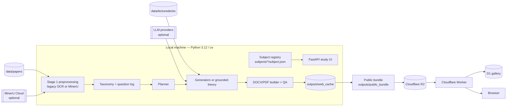
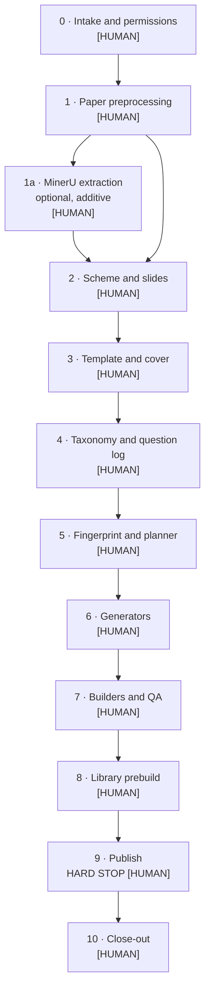
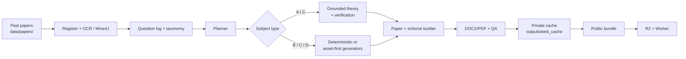

# Mock Paper Generator

A local-first study tool that learns the structure of past exam papers and
generates new mock papers and marking schemes. Generation runs on your machine;
the public site is a **library-only** deployment that serves pre-built papers
through Cloudflare.

The project is built around one idea: every generated paper must be traceable
to real source material, an explicit subject contract, and a human-approved
stage. It is not a generic question generator.

## Contents

- [At a glance](#at-a-glance)
- [How it fits together](#how-it-fits-together)
- [The subject lifecycle](#the-subject-lifecycle)
- [How a paper is made](#how-a-paper-is-made)
- [Quick start](#quick-start)
- [Subject status](#subject-status)
- [Repository map](#repository-map)
- [Common commands](#common-commands)
- [Public deployment](#public-deployment)
- [Safety and contribution rules](#safety-and-contribution-rules)
- [Documentation index](#documentation-index)
- [Tests](#tests)

## At a glance

| Item | Value |
|---|---|
| Purpose | Generate mock exam papers and marking schemes from past-paper structure |
| Local runtime | Python 3.12+, FastAPI, `uv` |
| Subjects | 44 registry entries: 5 `available`, 39 `coming_soon` |
| Available locally | CSC402, CSC413, CSC429, CSC662, MAT133 |
| Published | CSC413, CSC429, CSC662, MAT133 |
| Public site | <https://uitmpapergen.download> |
| Public runtime | Cloudflare Worker + R2 + D1; no Python and no LLM |
| Local UI | <http://127.0.0.1:8000> |
| Worker | `cloudflare/worker/` |
| Tests | `uv run pytest -q` and `cd cloudflare/worker && bun test` |
| Contact | auzair1990@gmail.com |
| Repository | <https://github.com/jerkfish/paper-generator> |

## How it fits together

The project has two deliberately separate environments.

- **Local generator** — reads past papers, lecture decks and subject plugins,
  optionally calls MinerU or an LLM, builds papers and schemes, and writes a
  private cache under `outputs/web_cache/<CODE>/`.
- **Public site** — serves a pre-built bundle from Cloudflare R2. It never
  runs Python, never makes an LLM call, and cannot generate new questions.



### Component map

| Layer | Key paths | Responsibility |
|---|---|---|
| Local UI | `src/app/` | Subject pages, generation jobs, Library, health and safety checks |
| Subject contract | `subjects/<CODE>/subject.json`, `src/subjects/registry.py`, `src/subjects/plugins.py` | Registry-driven subject metadata, capabilities and plugin loading |
| Subject implementations | `src/subjects/<code>/` | Planner, generators, builders and subject-specific rules |
| Preprocessing | `src/subjects/preprocess.py`, `src/ingest/`, `src/subjects/parsers/` | Paper register, OCR, MinerU extraction and normalization |
| Theory | `src/theory/` | Lecture-deck retrieval and grounded question drafting for type A/C subjects |
| Shared assembly | `src/assemble/`, `src/subjects/templates.py`, `src/subjects/forbidden.py` | DOCX assembly, PDF export, templates and forbidden-token checks |
| Public bundle | `scripts/build_public_bundle.py` | Builds the static public site from the private cache |
| Public Worker | `cloudflare/worker/` | R2 document serving, generated routes and D1-backed gallery |

The registry is the single source of truth for subject routes, cache folders,
Library manifests and public pages. A hard-coded subject list in application
code is treated as a bug.

## The subject lifecycle

Every subject is onboarded through the same 11-stage playbook. Each stage has
a **[HUMAN]** gate: a person must review the evidence and approve the stage
before the lifecycle state moves to `done`.



### Stage reference

| Stage | Purpose | Main evidence |
|---|---|---|
| **0 · Intake** | Confirm code, title, curriculum order, subject type and permissions | `subjects/<CODE>/subject.json`, `lifecycle_state.json` |
| **1 · Paper preprocessing** | Register working copies, remove duplicate copies, extract text/OCR | `papers_register.json`, `papers_summary.json`, `paper_text/` |
| **1a · MinerU** | Optional figure/table/equation extraction for figure-heavy subjects | Full ZIP cache and `EXTRACTION_REPORT.md` per paper |
| **2 · Scheme and slides** | Confirm scheme/slide availability and permissions | `permissions`, deck inventory, deck map |
| **3 · Template and cover** | Install and approve the paper and scheme templates | `template_check.json`, approved template DOCX |
| **4 · Taxonomy and question log** | Derive topics, marks and traceable question metadata | `taxonomy.json`, `question_log.json` |
| **5 · Fingerprint and planner** | Turn the question log into a repeatable paper plan | Planner JSON / deterministic plan |
| **6 · Generators** | Implement every slot type the planner can emit | Generator modules, validation report |
| **7 · Builders and QA** | Assemble paper and scheme DOCX/PDF and run structural checks | `qa.json`, `meta.json`, rendered samples |
| **8 · Library prebuild** | Build the fixed 20-seed Library | `outputs/web_cache/<CODE>/` |
| **9 · Publish** | Build the public bundle, upload and deploy | Public bundle, R2 ledger, Worker deployment |
| **10 · Close-out** | Record final cost, evidence and unresolved items | Strict lifecycle status and `docs/<CODE>.md` |

A stage is not complete just because a file or cache folder exists. It needs:

1. a recorded status in `subjects/<CODE>/lifecycle_state.json`;
2. evidence paths that exist;
3. the required `[HUMAN]` approval;
4. no blocking `unsure` item;
5. the stage gates passing.

### Subject types

| Type | Meaning | Example | Generation |
|---|---|---|---|
| **A** | Slides + LLM theory | CSC662 | LLM drafts grounded theory questions from lecture decks; computed questions use deterministic plugins |
| **B** | Deterministic computed | CSC402, CSC413, MAT133 | Every question comes from a subject plugin; no LLM |
| **C** | Hybrid | ICT450 | Deterministic and/or grounded theory, depending on the subject contract |
| **D** | Asset-first assembly | CSC429 | Approved real-paper questions and assets; generators disabled |

The type is a contract in `subject.json`: `capabilities`, `plugins` and
`permissions` determine what the app may do. The app reads that contract at
runtime; it does not branch on a subject name.

### Lifecycle state

Each subject has a machine-readable state file:

```text
subjects/<CODE>/lifecycle_state.json
```

It records the current stage, status, evidence, blockers, human approvals,
`unsure` items and the actual LLM cost per stage. Query it with:

```bash
uv run python -m scripts.lifecycle_status <CODE>
```

If the file is missing, do not guess progress. Start at stage 0.

## How a paper is made



The important properties are:

- **Traceability** — every question, asset and mark points back to a source
  paper or an approved generator rule.
- **Determinism** — a seed reproduces the same paper. Type-B subjects make no
  LLM calls and cost $0.
- **Caching** — a cache key covers subject, mode, seed, computed marks, model
  and build settings. A cache hit costs $0.
- **Asset reuse** — figure-heavy subjects reuse real past-paper figures and
  tables. MinerU table HTML is rendered as a native Word table; figures use
  the extracted image crop.
- **Human review** — a plausible paper is not an approved paper. Stage 7
  requires a visual check of the cover, question layout, tables, marks and
  marking scheme.

## Quick start

```bash
uv sync
uv run python -m src.app.main
# open http://127.0.0.1:8000
```

Or run the app directly with Uvicorn:

```bash
uv run uvicorn src.app.main:app --host 127.0.0.1 --port 8000
```

Type-B subjects (CSC402, CSC413, MAT133) work without an API key. CSC662 live
generation needs a key in `.env`; the file is gitignored. Keys are read from
the environment only:

```text
DEEPSEEK_API_KEY=...
GEMINI_API_KEY=...
```

`GEMINI_API_KEY=REPLACE_WITH_GEMINI_API_KEY` in `.env.example` is a placeholder.
Public builds fail closed if the real key is missing; generation does not
silently fall back to another provider.

### Local routes

| Route | Purpose |
|---|---|
| `/` | Subject table |
| `/<code>` | Subject hub |
| `/<code>/library` | Pre-built Library for that subject |
| `/<code>/generate` | Generate a paper from a seed |
| `/gallery` | Public gallery API preview |
| `/paused` | Daily-cap fallback notice |

## Subject status

| Subject | Title | Type | Local | Public | Notes |
|---|---|---|---|---|---|
| CSC402 | Programming I | B | Available | **Not published** | Stage 9 pending; publication permission is not granted |
| CSC413 | Introduction to Interactive Multimedia | B | Available | Published | 20-paper deterministic Library |
| CSC429 | Computer Organization and Architecture | D | Available | Published | Approved real-paper question/asset assembly |
| CSC662 | Computer Security | A | Available | Published | LLM theory + computed generators; 20-paper Library |
| MAT133 | Pre-Calculus | B | Available | Published | 57 deterministic generators; 20-paper Library |
| ICT450 | Database Design and Development | C | In onboarding | Not published | Stage 7 revision 3 awaiting visual approval |

The remaining 38 registry entries are `coming_soon` curriculum stubs with no
papers, templates or Library cache yet.

## Repository map

```text
subjects/<CODE>/subject.json       Subject contract and permissions
subjects/<CODE>/lifecycle_state.json Stage, evidence, blockers and cost
src/subjects/<code>/               Subject planner, generators and builders
src/subjects/registry.py           Registry loader
src/subjects/preprocess.py         Shared paper register/corpus stage
src/subjects/parsers/              MinerU client and normalizer
src/subjects/templates.py          Template install/check
src/subjects/forbidden.py          Forbidden-token and private-path checks
src/theory/                        Lecture retrieval and grounded theory
src/assemble/                      Shared DOCX/PDF assembly
src/app/                           FastAPI local UI and job runner
scripts/                           Onboarding, bundle, R2 and lifecycle tools
cloudflare/worker/                 Library-only Worker and gallery
data/papers/<CODE>/                Read-only working copies of past papers
data/reference/<CODE>/             Templates, crests and cover assets
data/lecturedecks/<CODE>/          Lecture decks, where used
data/tracking/<code>/              Extraction, taxonomy and planner artifacts
outputs/web_cache/<CODE>/          Private pre-built Library
outputs/public_bundle/             Public static bundle
docs/                              Playbook, lifecycle and per-subject reports
```

## Common commands

| Task | Command |
|---|---|
| Run the local UI | `uv run python -m src.app.main` |
| Run all Python tests | `uv run pytest -q` |
| Run Worker tests | `cd cloudflare/worker && bun test` |
| Check for leaked secrets | `uv run python -m src.app.safety --check` |
| Show subject progress | `uv run python -m scripts.lifecycle_status <CODE>` |
| Scaffold a subject | `uv run python -m scripts.new_subject <CODE> --type A|B|C --dry-run` |
| Register papers | `uv run python -m src.subjects.preprocess --subject <CODE> --register --corpus` |
| Check a template | `uv run python -m src.subjects.templates --subject <CODE> --check` |
| Build one sample seed | `uv run python -m src.app.prebuild_library --seeds 1 --subject <CODE> --force` |
| Build the 20-seed Library | `uv run python -m src.app.prebuild_library --seeds 1-20 --subject <CODE>` |
| Build the public bundle | `uv run python -m scripts.build_public_bundle --out outputs/public_bundle` |
| R2 dry run | `uv run python -m scripts.r2_sync --bundle outputs/public_bundle` |

Stage 9 is a hard stop. The R2 upload and Worker deploy commands are documented
in `docs/LIFECYCLE.md`; never run them without explicit publication approval.

## Public deployment

| Item | Current value |
|---|---|
| Public site | <https://uitmpapergen.download> |
| `www` | <https://www.uitmpapergen.download> → 301 → apex |
| Worker fallback | <https://papergen.jerkfish123.workers.dev> |
| Public subjects | CSC413, CSC429, CSC662, MAT133 |
| R2 snapshot | 478 objects, 118,250,782 bytes |
| R2 quota used | 516 Class A, 0 Class B (November 2026) |
| D1 database | `papergen` |
| R2 bucket | `exampapers` |
| Worker source | `cloudflare/worker/` |

The Worker:

- serves static pages and documents from R2;
- resolves subject routes from the generated `subjects.json`;
- exposes a D1-backed gallery with 7-day share expiry;
- has no Python runtime, no API key and no live generation.

The public bundle is built locally, validated on forbidden paths and missing
manifests, then uploaded only after stage 9 approval. The live container mode
is scaffolded in `cloudflare/container-worker/` but **not deployed**; it
requires Cloudflare Workers Paid and Docker. See `docs/DEPLOY_LIVE.md`.

## Safety and contribution rules

These rules apply to every contributor and every automated agent.

- **Originals are read-only.** Never edit, rename, move or delete supplied
  papers in `CSC662/`, `data/papers/<CODE>/` source files,
  `data/reference/<CODE>/` or `data/lecturedecks/<CODE>/`. Stage 1 works on
  copies under `data/papers/<CODE>/`.
- **Never publish without an explicit human instruction.** Building a local
  bundle is not publishing. R2 upload and Worker deploy are stage 9 only.
- **No secrets in the repository.** Read keys from the environment; never
  print, log or commit key values.
- **Record uncertainty.** Noisy covers, missing assets, unconfirmed
  permissions and unvalidated generators go into `unsure` in
  `lifecycle_state.json`. Never invent a month, mark, answer or test result.
- **Every stage has a [HUMAN] gate.** Do not mark a stage `done` without
  evidence and approval.
- **No hard-coded subject lists.** Application code reads the registry or the
  generated `subjects.json`.
- **A human operator owns git.** Automated agents must not run `git commit`,
  `git push`, `git pull` or any other repository mutation. A human operator
  reviews and commits changes.

### Gate checklist

Run these at every stage:

```bash
uv run python -m src.app.safety --check
uv run pytest -q
cd cloudflare/worker && bun test
uv run python -m scripts.lifecycle_status <CODE>
```

Stop at the stage's `[HUMAN]` gate and report the evidence, `unsure` items and
actual LLM cost so far.

## Documentation index

| Document | Read it for |
|---|---|
| `docs/SUBJECT_PLAYBOOK.md` | The authoritative 11-stage onboarding procedure, evidence rules and [HUMAN] gates |
| `docs/LIFECYCLE.md` | Local generation, public bundle, R2 upload, Worker serving and gallery lifecycle |
| `docs/<CODE>.md` | Per-subject decisions, commands, deviations and caveats |
| `docs/CSC429.md` | Type-D asset-first assembly example |
| `docs/ICT450.md` | Current type-C onboarding report and Stage 7 status |
| `docs/MAT133.md`, `docs/MAT133_TAXONOMY.md` | Deterministic paper-derived generator and taxonomy example |
| `docs/DEPLOY_LIVE.md` | Optional live container mode, cost and secrets |
| `AGENTS.md` | Repository rules for automated agents |
| `design/` | Public page design and public-bundle allowlist |

## Tests

```bash
uv run pytest -q
cd cloudflare/worker && bun test
```

Coverage includes the planner/verifier, job lifecycle, cost-cap abort, cache
hits, subject discovery, Library rendering, public-bundle validation, secret
scanning, private-path guards, R2 quota guards, MinerU normalization, the
deterministic MAT133 generators, the ICT450 builders and the Worker API.

Current suite: **366 passed, 12 skipped** Python tests and **6 passed** Worker
tests. Counts are a snapshot; run the commands above for the current result.
