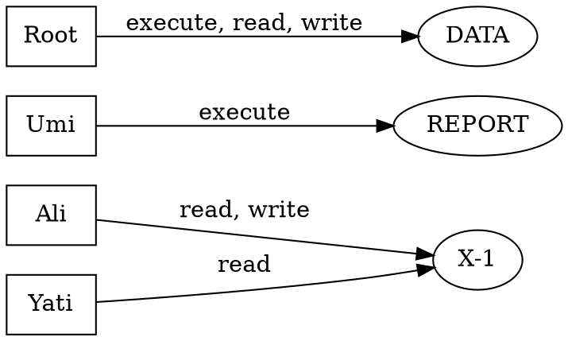
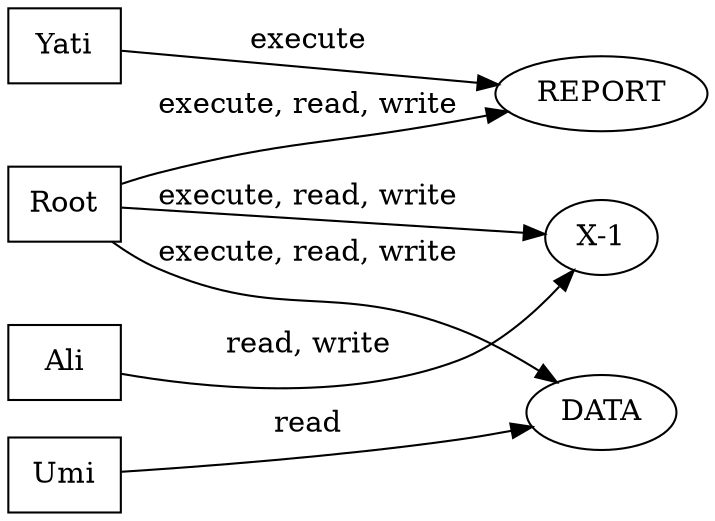
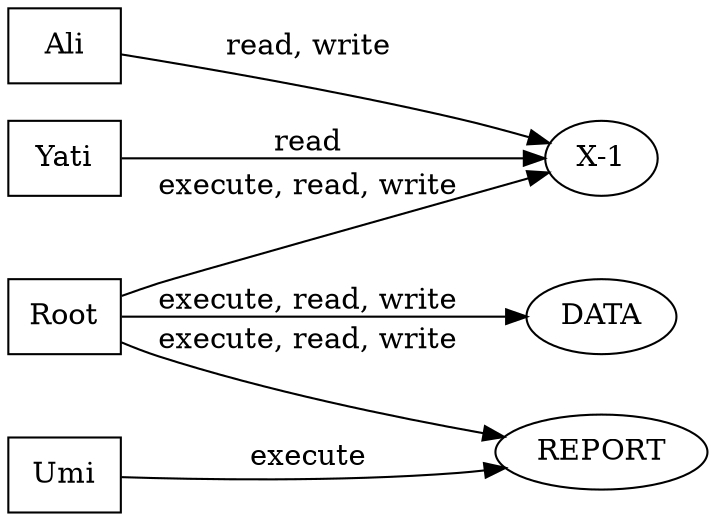
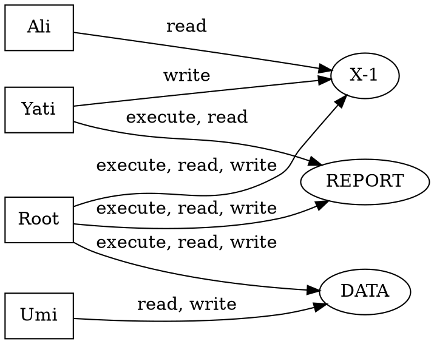
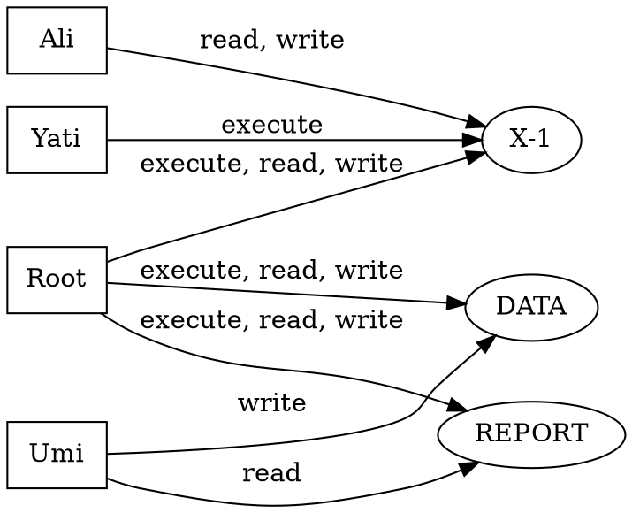

# Computed sample questions - ACM / ACL / capability lists

Scenarios drafted by the LLM (qwen3.7-flash) - names and rights only. Matrix, ACLs, capability lists and the diagram are built by code; consistency is machine-verified (each view rebuilds the others).

Note: the Graphviz `dot` binary is not installed on this machine, so diagrams are emitted as `.dot` sources (rendered by any Graphviz installer).

## Question 1 (6 marks)

```
Assume a computer system with the accounts: Ali, Yati, Umi, Root.

Ali can read, write X-1.
Yati can read X-1.
Umi can execute REPORT.
Root can execute, read, write DATA.

a) Write the access control matrix (ACM).
b) Write a set of access control lists (ACL).
c) Write a set of capability lists (CL).
(6 marks)
```
| Subject \ Object | X-1 | REPORT | DATA |
|---|---|---|---|
| Ali | readwrite | - | - |
| Yati | read | - | - |
| Umi | - | execute | - |
| Root | - | - | executereadwrite |

**ACLs (per object):**
- X-1 -> Ali: readwrite; Yati: read
- REPORT -> Umi: execute
- DATA -> Root: executereadwrite

**Capability lists (per subject):**
- Ali -> X-1: readwrite
- Yati -> X-1: read
- Umi -> REPORT: execute
- Root -> DATA: executereadwrite

**Diagram (Graphviz dot):**



## Question 2 (6 marks)

```
Assume a computer system with the accounts: Ali, Yati, Umi, Root.

Ali can read, write X-1.
Yati can execute REPORT.
Umi can read DATA.
Root can execute, read, write X-1.
Root can execute, read, write REPORT.
Root can execute, read, write DATA.

a) Write the access control matrix (ACM).
b) Write a set of access control lists (ACL).
c) Write a set of capability lists (CL).
(6 marks)
```
| Subject \ Object | X-1 | REPORT | DATA |
|---|---|---|---|
| Ali | readwrite | - | - |
| Yati | - | execute | - |
| Umi | - | - | read |
| Root | executereadwrite | executereadwrite | executereadwrite |

**ACLs (per object):**
- X-1 -> Ali: readwrite; Root: executereadwrite
- REPORT -> Root: executereadwrite; Yati: execute
- DATA -> Root: executereadwrite; Umi: read

**Capability lists (per subject):**
- Ali -> X-1: readwrite
- Yati -> REPORT: execute
- Umi -> DATA: read
- Root -> DATA: executereadwrite; REPORT: executereadwrite; X-1: executereadwrite

**Diagram (Graphviz dot):**



## Question 3 (6 marks)

```
Assume a computer system with the accounts: Ali, Yati, Umi, Root.

Ali can read, write X-1.
Yati can read X-1.
Umi can execute REPORT.
Root can execute, read, write X-1.
Root can execute, read, write REPORT.
Root can execute, read, write DATA.

a) Write the access control matrix (ACM).
b) Write a set of access control lists (ACL).
c) Write a set of capability lists (CL).
(6 marks)
```
| Subject \ Object | X-1 | REPORT | DATA |
|---|---|---|---|
| Ali | readwrite | - | - |
| Yati | read | - | - |
| Umi | - | execute | - |
| Root | executereadwrite | executereadwrite | executereadwrite |

**ACLs (per object):**
- X-1 -> Ali: readwrite; Root: executereadwrite; Yati: read
- REPORT -> Root: executereadwrite; Umi: execute
- DATA -> Root: executereadwrite

**Capability lists (per subject):**
- Ali -> X-1: readwrite
- Yati -> X-1: read
- Umi -> REPORT: execute
- Root -> DATA: executereadwrite; REPORT: executereadwrite; X-1: executereadwrite

**Diagram (Graphviz dot):**



## Question 4 (6 marks)

```
Assume a computer system with the accounts: Ali, Yati, Umi, Root.

Ali can read X-1.
Yati can write X-1.
Yati can execute, read REPORT.
Umi can read, write DATA.
Root can execute, read, write X-1.
Root can execute, read, write REPORT.
Root can execute, read, write DATA.

a) Write the access control matrix (ACM).
b) Write a set of access control lists (ACL).
c) Write a set of capability lists (CL).
(6 marks)
```
| Subject \ Object | X-1 | REPORT | DATA |
|---|---|---|---|
| Ali | read | - | - |
| Yati | write | executeread | - |
| Umi | - | - | readwrite |
| Root | executereadwrite | executereadwrite | executereadwrite |

**ACLs (per object):**
- X-1 -> Ali: read; Root: executereadwrite; Yati: write
- REPORT -> Root: executereadwrite; Yati: executeread
- DATA -> Root: executereadwrite; Umi: readwrite

**Capability lists (per subject):**
- Ali -> X-1: read
- Yati -> REPORT: executeread; X-1: write
- Umi -> DATA: readwrite
- Root -> DATA: executereadwrite; REPORT: executereadwrite; X-1: executereadwrite

**Diagram (Graphviz dot):**



## Question 5 (6 marks)

```
Assume a computer system with the accounts: Ali, Yati, Umi, Root.

Ali can read, write X-1.
Yati can execute X-1.
Umi can read REPORT.
Umi can write DATA.
Root can execute, read, write X-1.
Root can execute, read, write REPORT.
Root can execute, read, write DATA.

a) Write the access control matrix (ACM).
b) Write a set of access control lists (ACL).
c) Write a set of capability lists (CL).
(6 marks)
```
| Subject \ Object | X-1 | REPORT | DATA |
|---|---|---|---|
| Ali | readwrite | - | - |
| Yati | execute | - | - |
| Umi | - | read | write |
| Root | executereadwrite | executereadwrite | executereadwrite |

**ACLs (per object):**
- X-1 -> Ali: readwrite; Root: executereadwrite; Yati: execute
- REPORT -> Root: executereadwrite; Umi: read
- DATA -> Root: executereadwrite; Umi: write

**Capability lists (per subject):**
- Ali -> X-1: readwrite
- Yati -> X-1: execute
- Umi -> DATA: write; REPORT: read
- Root -> DATA: executereadwrite; REPORT: executereadwrite; X-1: executereadwrite

**Diagram (Graphviz dot):**


